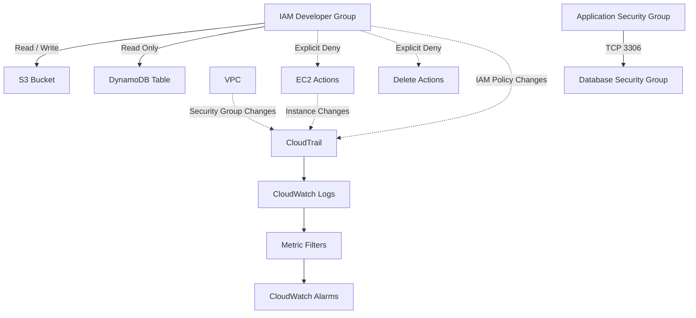

# AWS Security Incident

Security incident response infrastructure built with **AWS CDK**. The project demonstrates how to secure an AWS environment after an incident involving over-permissioned IAM access, potentially unsafe Security Group rules, and unauthorized infrastructure changes.

The solution implements least-privilege IAM policies, multi-region CloudTrail auditing, CloudWatch security alarms, and restricted VPC Security Groups.

## Stack

* AWS CDK
* TypeScript
* IAM
* CloudTrail
* CloudWatch Logs
* CloudWatch Alarms
* VPC
* Security Groups
* S3
* DynamoDB

## Architecture



## Project Structure

```text
security-incident/
├── bin/
│   └── security-incident.ts
├── lib/
│   └── security-incident-stack.ts
├── test/
│   └── security-incident.test.ts
├── cdk.json
├── package.json
├── tsconfig.json
└── README.md
```

## Security Controls

### IAM Least Privilege

A restricted developer group was created with access limited to the required resources.

S3 permissions:

* `s3:ListBucket`
* `s3:GetObject`
* `s3:PutObject`

DynamoDB permissions:

* `dynamodb:GetItem`
* `dynamodb:BatchGetItem`
* `dynamodb:Query`
* `dynamodb:Scan`
* `dynamodb:DescribeTable`

The group explicitly denies:

* EC2 actions
* S3 deletion
* DynamoDB deletion

This prevents developers from modifying EC2 infrastructure or deleting protected resources.

### CloudTrail

A multi-region CloudTrail trail was configured with:

* Multi-region auditing
* Global service events
* CloudWatch Logs integration
* File validation
* Seven-day CloudWatch Logs retention

CloudTrail records management API activity and provides the audit trail required for security investigations.

### CloudWatch Monitoring

Three security alarms were configured.

| Alarm                                    | Purpose                              |
| ---------------------------------------- | ------------------------------------ |
| `SecurityIncident-IAM-Policy-Changes`    | Detect IAM policy changes            |
| `SecurityIncident-EC2-Changes`           | Detect selected EC2 instance changes |
| `SecurityIncident-SecurityGroup-Changes` | Detect Security Group rule changes   |

Metric filters process CloudTrail events in CloudWatch Logs and publish security metrics used by the alarms.

### Security Groups

Two Security Groups were created:

**Application Security Group**

* No inbound rules
* All outbound traffic allowed

**Database Security Group**

* MySQL TCP `3306`
* Traffic allowed only from the Application Security Group
* No public MySQL access

No Security Group exposes SSH TCP `22` to `0.0.0.0/0`.

## Incident Response

### Finding 1 — Over-Permissioned Developer Access

The developer access model was restricted to the minimum required operations.

The final policy allows:

```text
S3
├── ListBucket
├── GetObject
└── PutObject

DynamoDB
├── GetItem
├── BatchGetItem
├── Query
├── Scan
└── DescribeTable
```

Explicit denies prevent deletion and EC2 operations.

### Finding 2 — Security Group Exposure

The application Security Group was configured without inbound access.

The database Security Group allows MySQL only from the application Security Group:

```text
Application SG
      │
      │ TCP 3306
      ▼
Database SG
```

There is no public `3306` access.

### Finding 3 — Security Group Change Detection

A temporary SSH rule was created during testing:

```text
TCP 22
Source: 45.225.227.92/32
```

The rule was intentionally limited to a single IP and was not exposed to the public internet.

CloudTrail recorded the `AuthorizeSecurityGroupIngress` event, which was processed by the CloudWatch metric filter.

The alarm transitioned from:

```text
OK → ALARM
```

The alarm reported:

```text
1 datapoint [1.0] was greater than or equal to the threshold (1.0)
```

The temporary rule was then revoked.

The final Application Security Group ingress configuration was:

```json
[]
```

This confirmed that no inbound SSH rule remained.

### Finding 4 — DynamoDB Incident Investigation

CloudTrail was queried for DynamoDB `UpdateTable` events around the requested incident period.

The investigation found legitimate events generated by AWS services such as:

* AWS Glue Crawler
* AWS CloudFormation

No unauthorized DynamoDB modification attributable to an unknown user was identified in the available CloudTrail management events.

DynamoDB data-plane operations such as `PutItem`, `UpdateItem`, and `DeleteItem` require CloudTrail data-event logging to be enabled in advance.

No unsupported user, IP address, or malicious action was therefore attributed to the reported incident.

## Validation

### CloudTrail

CloudTrail status was verified with:

```bash
aws cloudtrail get-trail-status \
  --name <trail-name> \
  --region us-east-1
```

The trail reported:

```text
IsLogging: true
LatestCloudWatchLogsDeliveryTime: <timestamp>
```

### IAM Policy Simulation

The restricted developer permissions were tested using IAM Policy Simulator.

| Action                        | Expected | Result         |
| ----------------------------- | -------- | -------------- |
| `s3:GetObject`                | Allow    | `allowed`      |
| `s3:PutObject`                | Allow    | `allowed`      |
| `s3:DeleteObject`             | Deny     | `explicitDeny` |
| `dynamodb:GetItem`            | Allow    | `allowed`      |
| `dynamodb:DeleteItem`         | Deny     | `explicitDeny` |
| `ec2:RunInstances`            | Deny     | `explicitDeny` |
| `ec2:ModifyInstanceAttribute` | Deny     | `explicitDeny` |

### CloudWatch Alarm

The Security Group alarm was successfully triggered by a temporary ingress rule.

Final state after the test:

```text
SecurityIncident-SecurityGroup-Changes
```

The alarm transitioned to:

```text
ALARM
```

demonstrating that Security Group modifications are detected through the CloudTrail and CloudWatch pipeline.

### Security Group Verification

The Application Security Group was verified with:

```bash
aws ec2 describe-security-groups \
  --group-ids <application-security-group-id> \
  --region us-east-1 \
  --query 'SecurityGroups[0].IpPermissions' \
  --output json
```

Final result:

```json
[]
```

This confirms that no inbound SSH rule remained after testing.

## Security Findings Summary

| Finding                                | Correction                      | Status            |
| -------------------------------------- | ------------------------------- | ----------------- |
| Excessive developer permissions        | Least-privilege IAM policies    | Resolved          |
| Developer could potentially modify EC2 | Explicit EC2 deny               | Resolved          |
| Developer could delete resources       | Explicit delete denies          | Resolved          |
| Unrestricted Security Group access     | Restricted Security Group rules | Resolved          |
| No monitoring for IAM changes          | CloudWatch alarm                | Resolved          |
| No monitoring for EC2 changes          | CloudWatch alarm                | Resolved          |
| No monitoring for SG changes           | CloudWatch alarm                | Resolved          |
| Historical DynamoDB incident           | CloudTrail investigation        | No evidence found |

## Deployment

Install dependencies:

```bash
npm install
```

Configure AWS credentials:

```bash
aws configure
```

Bootstrap CDK if required:

```bash
cdk bootstrap aws://ACCOUNT_ID/us-east-1
```

Deploy:

```bash
cdk deploy
```

The stack is deployed to:

```text
us-east-1
```

## Useful Commands

View the CloudFormation stack:

```bash
aws cloudformation describe-stacks \
  --stack-name SecurityIncidentStack \
  --region us-east-1
```

View CloudWatch alarms:

```bash
aws cloudwatch describe-alarms \
  --alarm-name-prefix SecurityIncident \
  --region us-east-1
```

View CloudTrail events:

```bash
aws cloudtrail lookup-events \
  --region us-east-1 \
  --max-results 10
```

View Security Group rules:

```bash
aws ec2 describe-security-groups \
  --group-ids <security-group-id> \
  --region us-east-1
```

## Cleanup

The infrastructure can be removed with:

```bash
cdk destroy
```

The temporary IAM test user should also be removed if it still exists:

```bash
aws iam remove-user-from-group \
  --user-name security-incident-developer-test \
  --group-name SecurityIncidentRestrictedDevelopers

aws iam delete-user \
  --user-name security-incident-developer-test
```

CloudTrail can create an S3 bucket for trail logs. If the bucket contains objects after the stack is removed, empty the bucket before deleting it.

## Lessons Learned

* Least-privilege IAM policies reduce the impact of compromised credentials.
* Explicit denies provide an additional protection layer for critical actions.
* CloudTrail provides the audit trail required for incident investigation.
* CloudWatch metric filters can convert CloudTrail security events into actionable alarms.
* Security Groups should expose only the traffic required by the application.
* Security investigations should distinguish legitimate AWS service activity from unauthorized actions.
* Historical data-plane activity cannot be recovered through CloudTrail if the required data-event logging was not enabled at the time.
